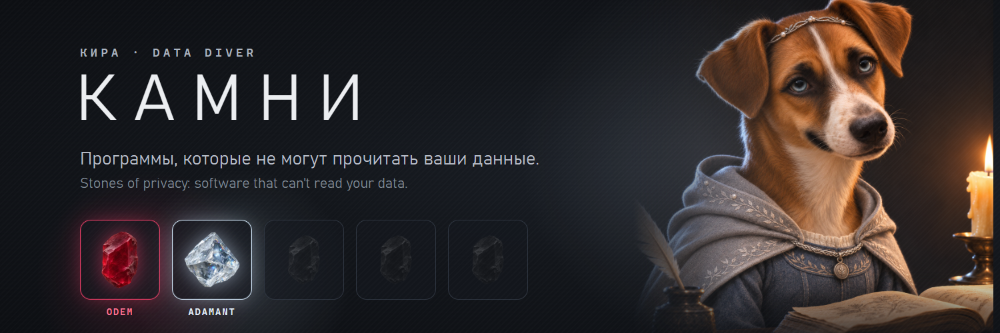

  

<a href="#ru">Русский</a> · <a href="#en">English</a>

<h1 align="center">КАМНИ</h1>

<em>Программы, которые не могут прочитать ваши данные.</em>

Каждый камень - закрытая программа, которая бережёт ваши данные. Общее у всех: работа без интернета и без облака, ничего не уходит наружу. Разное - задача и цвет. Лицо здесь не важно - важен код, поэтому образ проекта - Кира.

## Камни

| Камень | Что делает | Статус |
| :--- | :--- | :--- |
| 🔴 [Одем](#одем) | Бухгалтерия, которую невозможно прочитать извне | Бета 1.2.0, [демо](https://datadiver-ru.github.io/demo.html) |
| 💎 [Адамант](#адамант) | Проверка защиты Windows и своей сети | Вышел · 1.2.4, [скачать](https://github.com/datadiver-ru/adamant/releases) |
| ⚪️ Топаз | Юридическая версия | План |
| ⚪️ Карбункул | Для нотариусов | План |

### Одем

Бухгалтерия для небольших компаний. Первый камень: рождён из огня, стал защитой.

- Данные шифруются на вашем компьютере (AES-256-GCM), ключ живёт только в памяти.
- Журнал аудита подписан (Ed25519), аудитор проверяет его без пароля.
- Работает без интернета и облака. КУДиР, декларация по УСН в XML, выгрузки для 1С.
- Криптокошельки, выплаты по каналам, синхронизация через общую папку (туда уходит только шифр).

[Об Одеме](https://datadiver-ru.github.io/odem.html) · [Демо в браузере](https://datadiver-ru.github.io/demo.html) · [Летопись](https://datadiver-ru.github.io/chronicle.html) · [Ключ «Бизнес» в боте](https://t.me/datadiver_shop_bot)

### Адамант

Проверка защиты компьютера с Windows и своей домашней или офисной сети. Адамант - старинное имя алмаза, «несокрушимый».

- Индекс защиты от 0 до 100 и «чистота камня» - видно, крепнет защита или слабеет.
- Страж запоминает систему и показывает, что изменилось; чек-лист на 31 совет.
- Исправления кнопкой с откатом. Сама ничего не отправляет в интернет.
- Бесплатно - всё, что защищает. Полная версия добавляет Bluetooth, защиту входа, учения, «Пока вас не было» и «Закрыть лишнее»: одна кнопка закрывает все ненужные порты, видно, что перестанет работать, откат одной кнопкой.

[Об Адаманте](https://datadiver-ru.github.io/adamant.html) · [Скачать](https://github.com/datadiver-ru/adamant/releases) · [Исходный код](https://github.com/datadiver-ru/adamant) (открыт для просмотра) · [Ключ полной версии в боте](https://t.me/datadiver_shop_bot)

## Принципы

- **Zero-knowledge** - «Мы не можем прочитать ваши данные.»
- **Open-core** - «Ядро будет открыто. Приватность бесплатна.»
- **Offline-first** - «Работает без интернета.»

## Ссылки

- [Сайт](https://datadiver-ru.github.io/) · [Все камни](https://datadiver-ru.github.io/stones.html)
- Читать: Telegram-канал [Кира · Data Diver](https://t.me/datadiver_ru) · [LinkedIn](https://www.linkedin.com/in/datadiverru)
- Ключи к камням: Telegram-бот Киры [@datadiver_shop_bot](https://t.me/datadiver_shop_bot)
- Связь и сообщения об уязвимостях: data.diver.ru@gmail.com · Telegram [@data_diver_ru](https://t.me/data_diver_ru)

Аватар - Кира. Лицо не важно. Важен код.

---

<h1 align="center">STONES</h1>

<em>Software that can't read your data.</em>

Each stone is closed software that protects your data. What they share: offline, no cloud, nothing leaves your machine. What differs is the job and the colour. The face doesn't matter - the code does, so the face of the project is Kira.

## Stones

| Stone | What it does | Status |
| :--- | :--- | :--- |
| 🔴 [Odem](#odem) | Accounting that cannot be read from outside | Beta 1.2.0, [demo](https://datadiver-ru.github.io/en/demo.html) |
| 💎 [Adamant](#adamant) | Security check for Windows and your own network | Released · 1.2.4, [download](https://github.com/datadiver-ru/adamant/releases) |
| ⚪️ Topaz | Legal edition | Planned |
| ⚪️ Carbuncle | For notaries | Planned |

### Odem

Accounting for small companies. The first stone: born of fire, became protection.

- Data is encrypted on your machine (AES-256-GCM); the key lives only in memory.
- The audit log is signed (Ed25519) and an auditor can verify it without a password.
- Works offline, no cloud. Russian tax forms and 1C exports.
- Crypto wallets, payouts by channel, sync through a shared folder (only ciphertext goes there).

[About Odem](https://datadiver-ru.github.io/en/odem.html) · [Browser demo](https://datadiver-ru.github.io/en/demo.html) · [Chronicle](https://datadiver-ru.github.io/en/chronicle.html) · [Business key in the bot](https://t.me/datadiver_shop_bot)

### Adamant

A security check for your Windows PC and your own home or office network. Adamant is an old name for diamond - "the unbreakable".

- A protection index from 0 to 100 and a stone clarity grade - see whether protection grows or fades.
- The Guard remembers your system and shows what changed; a 31-tip security checklist.
- One-click fixes with undo. Sends nothing to the internet on its own.
- Everything that protects you is free. The full version adds Bluetooth, sign-in protection, drills, "While you were away" and Close what is not needed: one button closes all unneeded ports, shows what will stop working, undo in one click.

[About Adamant](https://datadiver-ru.github.io/en/adamant.html) · [Download](https://github.com/datadiver-ru/adamant/releases) · [Source code](https://github.com/datadiver-ru/adamant) (available to read) · [Full version key in the bot](https://t.me/datadiver_shop_bot)

## Principles

- **Zero-knowledge** - “We cannot read your data.”
- **Open-core** - “The core will be open. Privacy is free.”
- **Offline-first** - “Works without the internet.”

## Links

- [Website](https://datadiver-ru.github.io/en/) · [All stones](https://datadiver-ru.github.io/en/stones.html)
- Follow: [LinkedIn](https://www.linkedin.com/in/datadiverru) · Telegram channel [Kira · Data Diver](https://t.me/datadiver_ru) (RU)
- Keys to the stones: Kira’s Telegram bot [@datadiver_shop_bot](https://t.me/datadiver_shop_bot)
- Contact and vulnerability reports: data.diver.ru@gmail.com · Telegram [@data_diver_ru](https://t.me/data_diver_ru)

The avatar is Kira. The face doesn’t matter. The code does.
